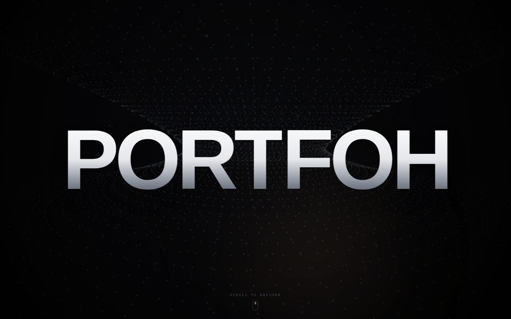
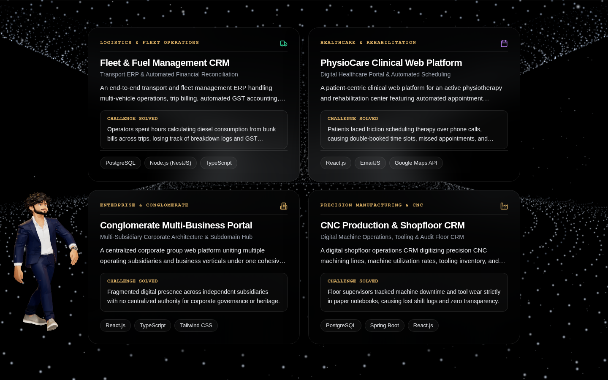
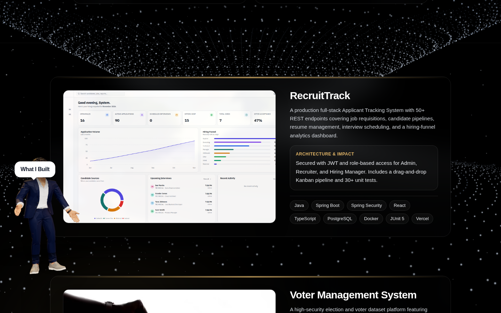
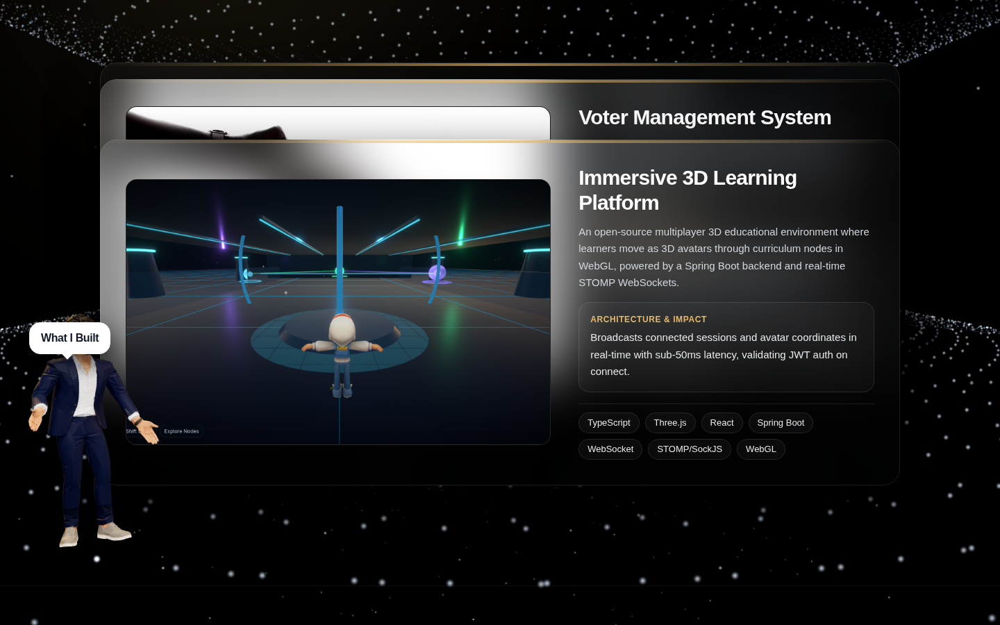
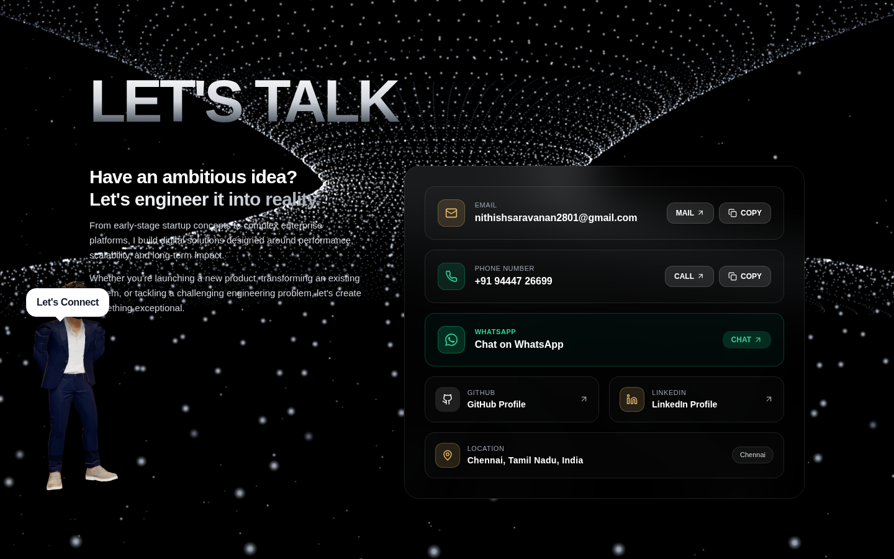
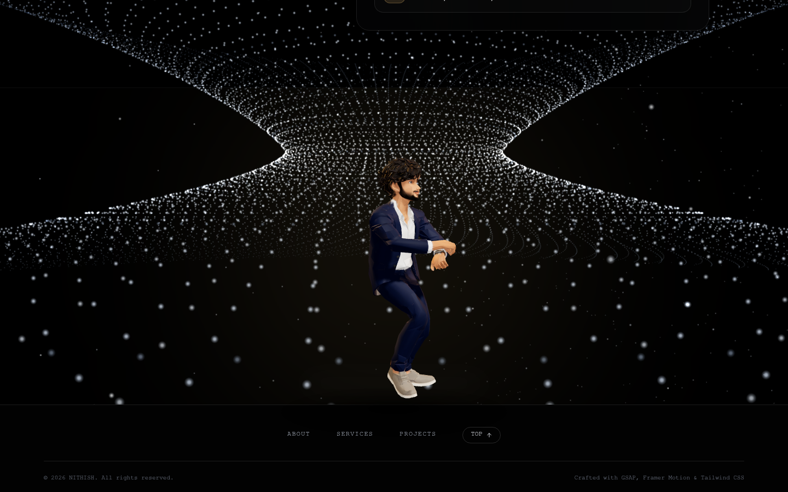

# Nithish Saravanan — 3D Cinematic Developer Portfolio

<div align="center">


<p align="center">
  <strong>An executive, high-performance 3D cinematic developer portfolio.</strong><br>
  Built with Three.js WebGL, procedural character rigging, elastic physics typography, particle vortex backgrounds, and champagne gold keynote illumination on pitch black.
</p>

</div>

---

## 📸 Visual Previews

### 1. Hero Stage & 3D Interactive Avatar
The landing experience features a custom canvas-calculated physics letter catapult, leading into a 3D animated avatar illuminated with executive champagne gold and warm amber studio rim lights.



---

### 2. Shipped Enterprise Systems
An interactive showcase of custom production applications engineered for real-world operations — featuring fleet ERPs, healthcare portals, conglomerate hubs, and manufacturing workflow automation.



---

### 3. Physical 3D Projects Deck
Layered physical cards with sticky scroll physics, custom architecture impact breakdowns, and hover action controls over real product screenshots.

<p align="center">
  
  
</p>

---

### 4. Interactive "Let's Talk" & Celebratory Stage
A high-contrast inquiry hub with instant clipboard actions, direct messaging channels, and a celebratory 3D dance floor anchored right before the footer.

<p align="center">
  
  
</p>

---

## ⚡ Technical Highlights

- **Interactive 3D WebGL Avatar (`Three.js`)**: Real-time 3D character with procedural FK armature rigging, breathing idle, interactive mouse tracking, scroll-driven positional pathing, and smooth dancing choreography.
- **Executive Champagne Gold Lighting**: Directional key and rim lighting calibrated to `#E5B869` and `#D4A373` on pure `#020202` pitch-black glassmorphism.
- **Physics Letter Catapult (`GSAP` + Canvas API)**: Dynamic bounding box measurement calculating letter mass, bounce curves, impact radial flashes, and explosive rotational dispersion.
- **Hyperboloid Particle Vortex**: 6,000+ GPU-instanced particle mathematical vortex rotating continuously in WebGL with depth fog attenuation.
- **Synthesized Web Audio Engine**: Procedural tone generator creating tactile, responsive audio feedback for clicks, hovers, and transitions without external audio asset downloads.
- **Scroll-Driven Typography**: Self-contained Word illuminating cards tracking scroll progress using Framer Motion.

---

## 🛠️ Tech Stack

| Domain | Technologies |
|---|---|
| **Core Framework** | React 18, TypeScript, Vite |
| **3D & WebGL** | Three.js, Canvas API, WebGL Shaders |
| **Motion & Animation** | GSAP, Framer Motion |
| **Styling & System** | Tailwind CSS, Lucide Icons, Canvas Confetti |
| **Audio** | Native Web Audio API |
| **Deployment** | Vercel / GitHub Pages |

---

## 🚀 Getting Started

### Prerequisites
- Node.js (v18.0.0 or higher)
- npm or yarn / pnpm

### Installation

1. Clone the repository:
   ```bash
   git clone https://github.com/NithishSaravananRss/3d-Portfolio.git
   cd 3d-Portfolio
   ```

2. Install dependencies:
   ```bash
   npm install
   ```

3. Run the development server:
   ```bash
   npm run dev
   ```
   Open `http://localhost:3000` in your browser.

4. Build for production:
   ```bash
   npm run build
   ```
   The compiled static bundle will be generated in `dist/`.

---

## 👨‍💻 Author

**Nithish Saravanan**
- **Role**: Software Engineer
- **GitHub**: [@NithishSaravananRss](https://github.com/NithishSaravananRss)
- **LinkedIn**: [Nithish Saravanan](https://linkedin.com/in/nithish-saravanan-s)
- **Email**: [nithishsaravanan2801@gmail.com](mailto:nithishsaravanan2801@gmail.com)
